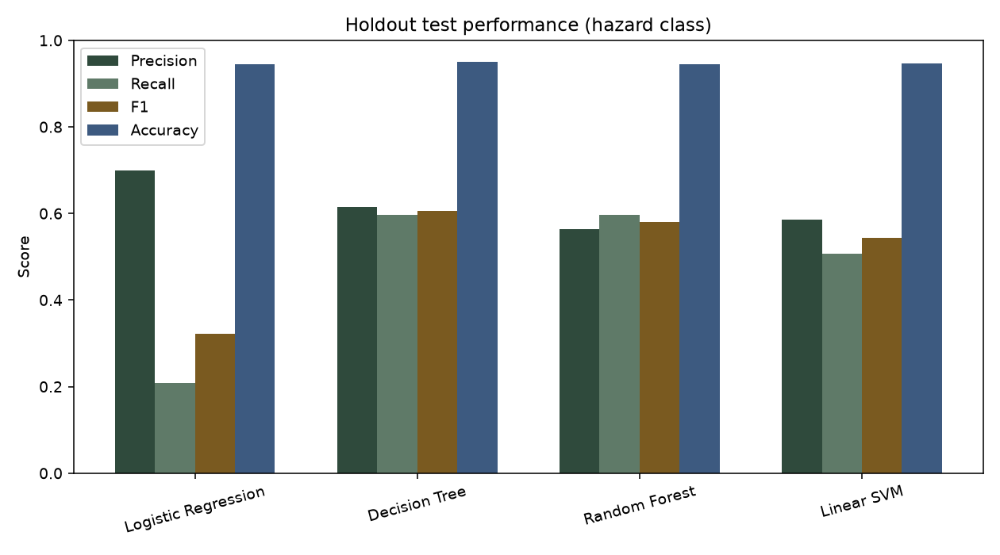
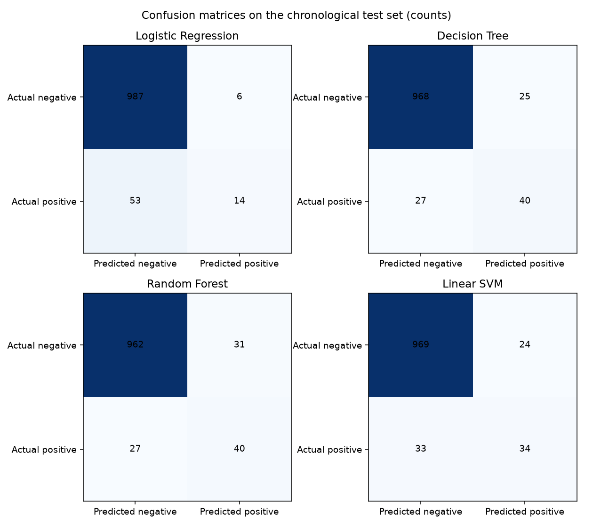
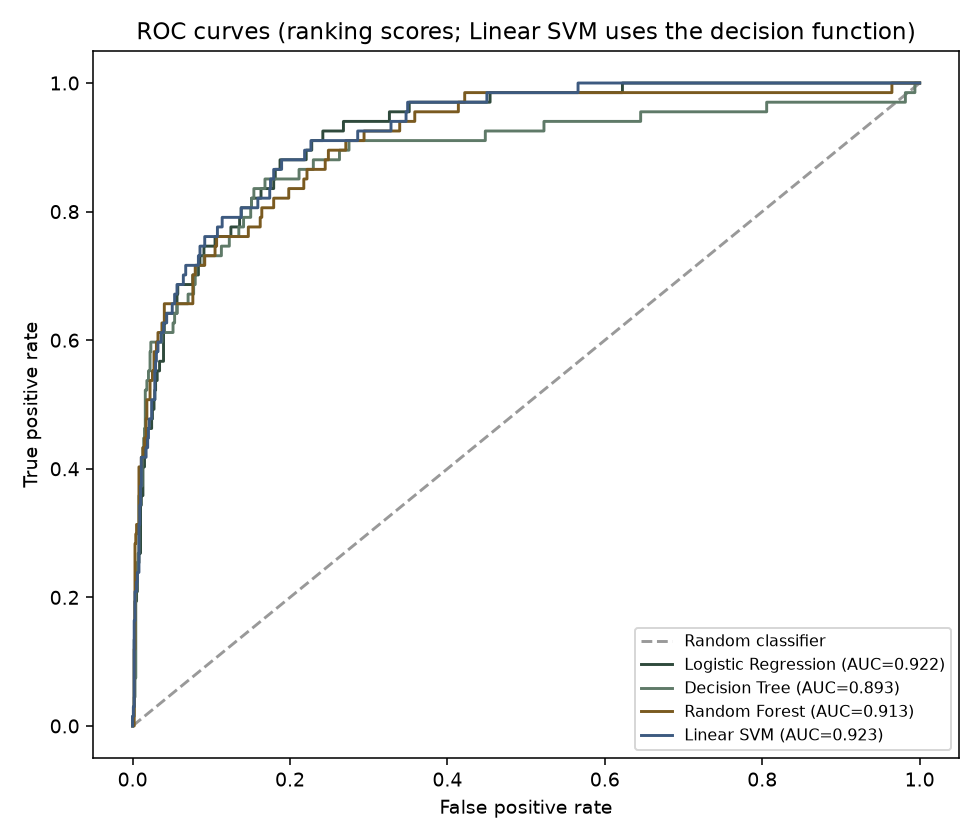
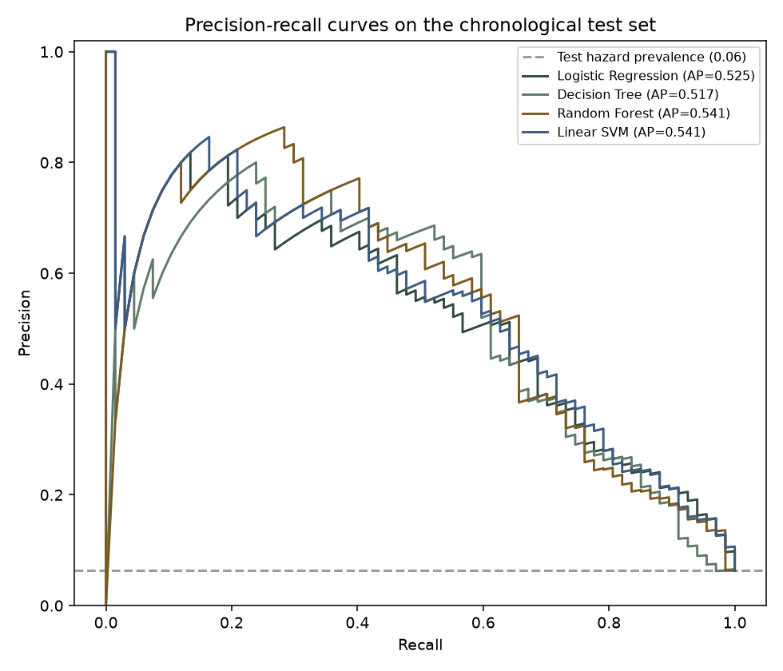
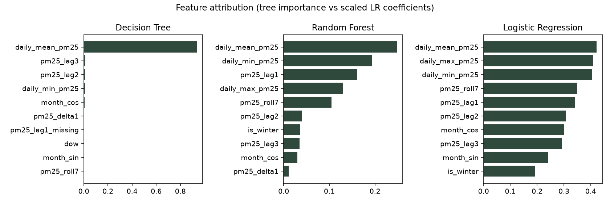
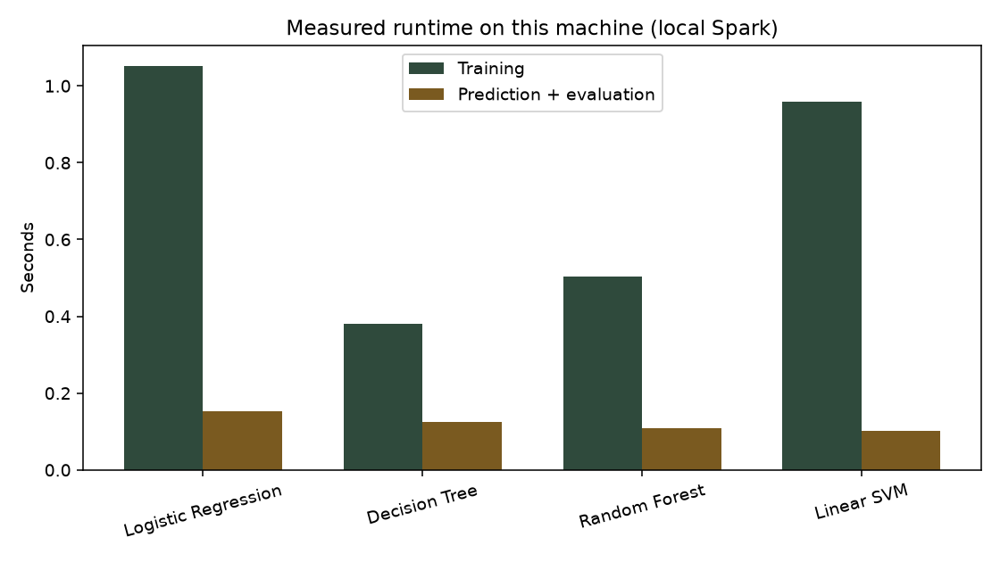
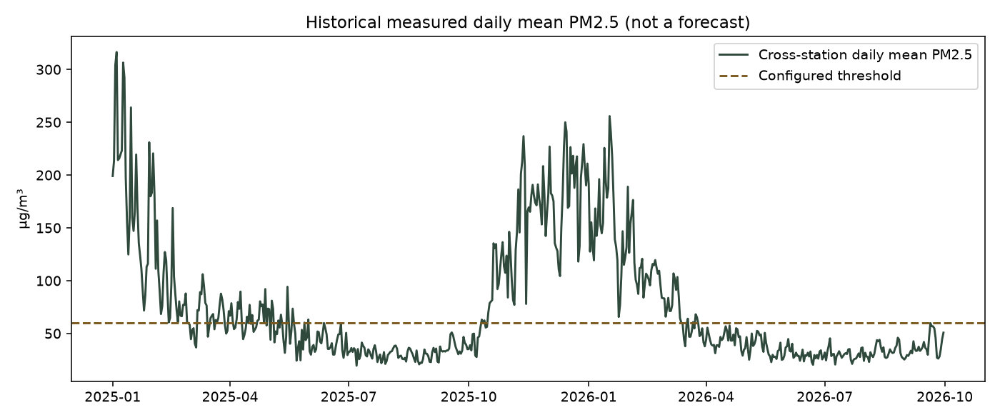
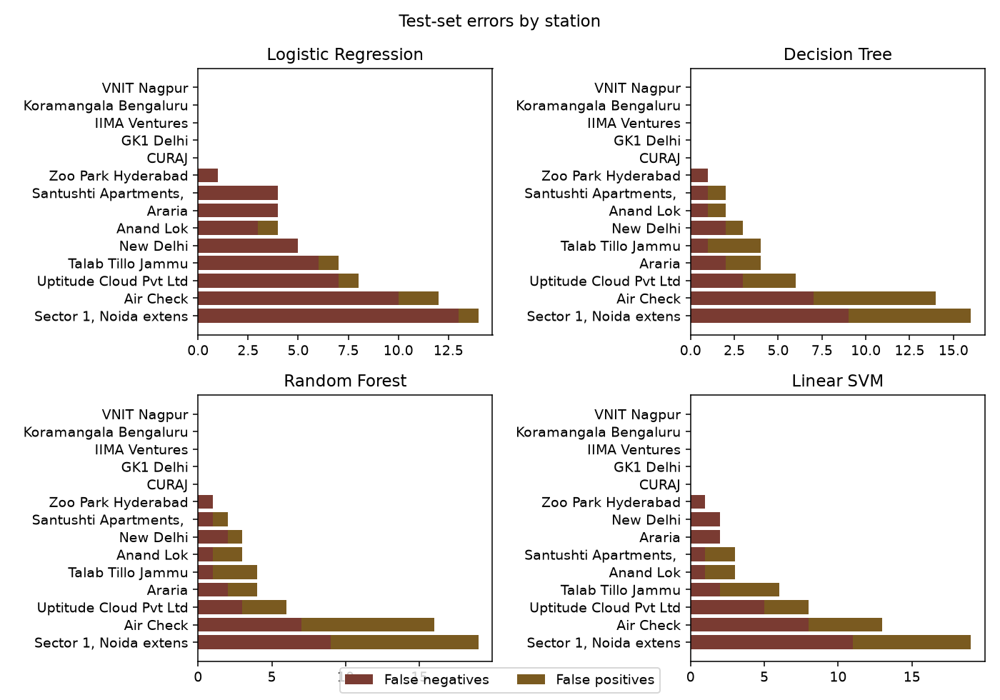

# AirCast India — Model Results, Architecture, and Decision Analysis

This document records the **actual** PySpark training run completed on 16 October 2026. Every metric, confusion count, curve, and plot comes from `outputs/model_evaluation/`, which the FastAPI backend reads and serves to the website. Nothing here is a placeholder score.

## 1. Direct answers

### Why the date picker looked stuck

The original forecast control set `min` and `max` to the **same** date: the next local calendar day after the station’s latest labelled feature row. For GK1 Delhi that was **30 September 2026**. The calendar therefore had only one selectable day. That was intentional for a next-day model, but it felt broken.

The control now allows **any date in the station’s labelled feature range**. Each chosen date is still interpreted as “predict the next local day after the feature row for the previous calendar day.” If that row does not exist, the API returns an error instead of inventing data.

### Why the predicted box showed “—%”

A prediction **did** return. The subtitle already said:

> No hazard · target 2026-09-30 · Linear SVM

The large number stayed `—%` because the **preferred model is Linear SVM**, and Spark `LinearSVC` does **not** emit a calibrated probability. The UI was written to show a percentage only when `probability_supported` is true. That is honest, but it looked empty.

The headline now shows **No hazard** / **Hazard** when there is no probability, and still shows a percentage for Logistic Regression, Decision Tree, and Random Forest.

### Which model has the best performance?

There are two honest answers:

| Question | Answer |
| --- | --- |
| Which model was **selected** for the API? | **Linear SVM** — highest **validation** F1 (0.560), declared before looking at the test set. |
| Which model looks strongest on the **untouched test set**? | **Decision Tree** — highest test F1 (0.606) and tied-highest hazard recall (0.597). |

Accuracy is a poor ranking statistic here. The test set is only **6.3%** hazard days, so always predicting “no hazard” would already be about 94% accurate.

---

## 2. Task and data

**Task.** Binary classification: will tomorrow’s daily mean PM2.5 at this station exceed a **project-configured** 60 µg/m³ threshold? That threshold is not treated as an official Indian regulatory cutoff.

**Label.** `label = 1` if the next `Asia/Kolkata` calendar day’s daily mean > 60. Features never include that future mean.

**Active dataset.** Expanded OpenAQ PM2.5, 14 stations, 4,666 labelled station-days (1,648 hazard / 3,018 none), 2025-01-01 to 2026-09-29.

**Predictors (no IDs, no future columns):**

`valid_reading_count`, `daily_mean_pm25`, `daily_min_pm25`, `daily_max_pm25`, `pm25_lag1`, `pm25_lag2`, `pm25_lag3`, `pm25_roll7`, `pm25_delta1`, `month_sin`, `month_cos`, `is_winter`, `dow`, plus missingness indicators for the lag/roll/delta fields.

Missing lags were **not** dropped. A mean imputer was fit on the training partition only.

---

## 3. Chronological split

Unique `local_date` values were split 70% / 15% / 15%. Stations that share a calendar date stay in the same partition.

| Partition | Dates | Rows | Hazard / none | Prevalence |
| --- | --- | --- | --- | --- |
| Train | 2025-01-01 to 2026-03-22 | 2,375 | 1,430 / 945 | 60.2% |
| Validation | 2026-03-23 to 2026-06-25 | 1,231 | 151 / 1,080 | 12.3% |
| Test | 2026-06-26 to 2026-09-29 | 1,060 | 67 / 993 | 6.3% |

Winter-heavy training versus a summer/monsoon test set is the main reason Logistic Regression’s test recall collapses. That is a dataset property, not a coding error.

Spark: **3.5.9**, mode **local[2]**, seed **42**.

---

## 4. Selection rule (declared before test inspection)

Choose the classifier with the highest **validation** F1 for the hazard class. Break ties with validation recall, then simplicity: logistic regression, decision tree, linear SVM, random forest.

Validation F1:

| Model | Val F1 | Val recall |
| --- | --- | --- |
| Linear SVM | **0.560** | 0.623 |
| Random Forest | 0.558 | 0.589 |
| Logistic Regression | 0.551 | 0.556 |
| Decision Tree | 0.507 | 0.510 |

**Preferred model for serving: Linear SVM.**

---

## 5. Holdout test metrics (same 1,060 rows for every model)

Positive class = next-day hazard.

| Model | Accuracy | Precision | Recall | F1 | Macro F1 | Weighted F1 | ROC-AUC | PR-AUC | Train s |
| --- | --- | --- | --- | --- | --- | --- | --- | --- | --- |
| Logistic Regression | 0.944 | 0.700 | 0.209 | 0.322 | 0.646 | 0.930 | 0.922 | 0.525 | 1.05 |
| Decision Tree | 0.951 | 0.615 | 0.597 | **0.606** | 0.790 | 0.951 | 0.893 | 0.517 | 0.38 |
| Random Forest | 0.945 | 0.563 | 0.597 | 0.580 | 0.775 | 0.946 | 0.913 | 0.541 | 0.50 |
| Linear SVM (preferred) | 0.946 | 0.586 | 0.507 | 0.544 | 0.758 | 0.944 | **0.923** | **0.541** | 0.96 |

Linear SVM ROC/PR use the **decision function**, not a probability.

### Confusion matrices (counts)

| Model | TN | FP | FN | TP |
| --- | --- | --- | --- | --- |
| Logistic Regression | 987 | 6 | 53 | 14 |
| Decision Tree | 968 | 25 | 27 | 40 |
| Random Forest | 962 | 31 | 27 | 40 |
| Linear SVM | 969 | 24 | 33 | 34 |

Logistic Regression almost never raises a false alarm (6 FP) but misses most hazards (53 FN). The trees catch 40 of 67 hazards and pay for it with more false alarms.

### Baselines on the same test set

| Baseline | Precision | Recall | F1 | Accuracy |
| --- | --- | --- | --- | --- |
| Persistence (today > 60 ⇒ tomorrow hazard) | 0.594 | 0.567 | **0.580** | 0.948 |
| Majority class from train (always hazard) | 0.063 | 1.000 | 0.119 | 0.063 |

On this shifted summer test set, persistence is competitive with the Spark models. That is an important limitation, not a reason to hide the baseline.

---

## 6. Per-model reading of the plots

All PNGs live in `outputs/model_evaluation/plots/` and are also drawn interactively on `/models` from `GET /api/v1/charts`.

### Plot 1 — Grouped performance



Accuracy bars are all ~0.94–0.95 and should not be used to pick a winner. The useful comparison is the brown F1 and grey recall bars: Decision Tree and Random Forest lead; Logistic Regression trails badly on recall.

### Plot 2 — Confusion matrices



Same 1,060 test rows. Logistic Regression’s right column is almost empty (few predicted hazards). The tree models predict more positives and recover more true hazards.

### Plot 3 — ROC



All four rank well above the diagonal. Linear SVM has the highest ROC-AUC (0.923) using its margin. A good ROC-AUC with a poor F1 (Logistic Regression) means the ranking is useful but the operating threshold, after validation tuning, still misses most summer hazards.

### Plot 4 — Precision-recall



The dashed baseline is the 6.3% test prevalence. Average precision is about 0.52–0.54 for every model — only a modest lift over a naive ranking on this rare-event test window.

### Plot 5 — Feature attribution



Tree plots are impurity importance. Logistic Regression bars are **scaled coefficients**, not the same quantity. Linear SVM coefficients are shown in the UI as coefficients, not “importance.”

### Plot 6 — Runtime



Local laptop Spark, not a cluster. All four models train in about 0.4–1.1 seconds on 2,375 rows.

### Plot 7 — Historical PM2.5



Cross-station **measured** daily means. This is not a forecast.

### Plot 8 — Errors by station



False negatives (missed hazards) and false positives by station. Coverage is uneven; a station with few summer days cannot dominate the comparison.

---

## 7. Decision analysis and conclusion

**What we optimized.** For a hazard warning, missed events (false negatives) and false alarms (false positives) are not equal. The predeclared rule therefore used validation F1, which balances precision and recall, rather than test-set cherry-picking.

**What the test set then showed.**

1. Seasonal shift is the dominant story. Train is 60% hazard; test is 6% hazard. A winter-trained linear model becomes very conservative.
2. Decision Tree has the best **test** F1 and shares the best recall with Random Forest.
3. Linear SVM, the selected model, is close to persistence on F1 (0.544 vs 0.580). It is the best validation model and the best ROC ranker, but it is **not** clearly better than “tomorrow repeats today’s exceedance” on this holdout.
4. Accuracy is misleading for all four models.

**Deployment judgement.** These results support **further experimentation**, not an operational air-quality warning system. Before any live use you would need a later-year holdout, station-specific calibration, and an explicit cost for missed winter versus summer events. Do not treat Linear SVM as “the best model” just because it is the API default.

**Practical recommendation.**

- Use **Linear SVM** in the current app because that is the validation-selected artifact the backend loads.
- Use **Decision Tree** if the goal of a slide or report is “best observed test F1 / recall.”
- Always show persistence next to the model.

---

## 8. How the result reaches the screen

```text
OpenAQ CSV
    → PySpark preprocess / features  (already completed)
    → scripts/train_and_evaluate_models.py
         four Spark MLlib pipelines
         outputs/model_evaluation/model_metrics.json
         outputs/model_evaluation/charts.json
         models/<name>/  +  models/inference_bundle.json
    → FastAPI  backend/app/main.py
         GET /api/v1/models/metrics   reads the JSON
         GET /api/v1/charts           reads charts.json
         POST /api/v1/predict         runs inference_bundle.json
         GET /api/forecast            preferred model (Linear SVM)
    → React  frontend/src/api/endpoints.ts
         fetch(VITE_API_BASE_URL + path)
    → Overview, Model Comparison, Predictions pages
```

### How to prove it is live, not hardcoded

1. Open `http://127.0.0.1:8001/docs` and call `GET /api/v1/models/metrics`. The F1 values match the table above.
2. Browser DevTools → Network: reload `/models`. You will see `GET /api/v1/charts` and `GET /api/v1/models/metrics`.
3. Submit a forecast. Network shows `GET /api/forecast` (Overview) or `POST /api/v1/predict` (Predictions). The JSON contains `model.name`, `decision_score` or `probability`, and `prediction_timestamp`.
4. Stop the API. The UI shows “Not connected” and does **not** invent metrics.

Frontend base URL: `frontend/.env` → `VITE_API_BASE_URL=http://127.0.0.1:8001`.

---

## 9. Important files

| File | Role |
| --- | --- |
| `scripts/train_and_evaluate_models.py` | Trains the four Spark estimators, writes metrics and plots |
| `aircast/constants.py` | Feature list, threshold, split fractions, selection rule |
| `aircast/split.py` | Date-based chronological split |
| `aircast/metrics.py` | Confusion, F1, ROC, PR, threshold search |
| `aircast/inference.py` | Applies the saved imputer/scaler/model to one row |
| `models/inference_bundle.json` | Portable copy of the Spark-trained parameters |
| `outputs/model_evaluation/model_metrics.json` | Full machine-readable results |
| `outputs/model_evaluation/model_comparison.csv` | Comparison table |
| `outputs/model_evaluation/plots/*.png` | Static report plots |
| `backend/app/main.py` | FastAPI app and `/api/v1` routers |
| `backend/app/services/store.py` | Loads metrics + inference bundle once |
| `backend/app/services/predictor.py` | Station/date → features → saved model |
| `backend/app/services/catalog.py` | Stations, hourly, daily series from Spark CSVs |
| `frontend/src/api/client.ts` | `apiGet` / `apiPost` |
| `frontend/src/api/endpoints.ts` | Typed calls to the API |
| `frontend/src/pages/ModelComparisonPage.tsx` | Four-model charts and table |
| `frontend/src/pages/ForecastPage.tsx` | Model picker + `POST /api/v1/predict` |
| `frontend/src/pages/DashboardPage.tsx` | Overview + preferred-model forecast |

### Model implementations (Spark, not scikit-learn)

```text
pyspark.ml.classification.LogisticRegression   L2, maxIter=100, scaled features
pyspark.ml.classification.DecisionTreeClassifier  gini, maxDepth=6, minInstances=8
pyspark.ml.classification.RandomForestClassifier  40 trees, sqrt features, depth 6
pyspark.ml.classification.LinearSVC             L2, maxIter=100, no probability
```

Imputer and `StandardScaler` are Spark pipeline stages fit on **training rows only**.

---

## 10. Run commands

```bash
export JAVA_HOME="$(brew --prefix openjdk@17)"
export SPARK_LOCAL_IP=127.0.0.1
source .venv/bin/activate
python scripts/train_and_evaluate_models.py
uvicorn backend.app.main:app --host 127.0.0.1 --port 8001
cd frontend && npm run dev -- --port 5174 --host 127.0.0.1
```

Website: `http://127.0.0.1:5174`  
API docs: `http://127.0.0.1:8001/docs`  
Model comparison page: `http://127.0.0.1:5174/models`
